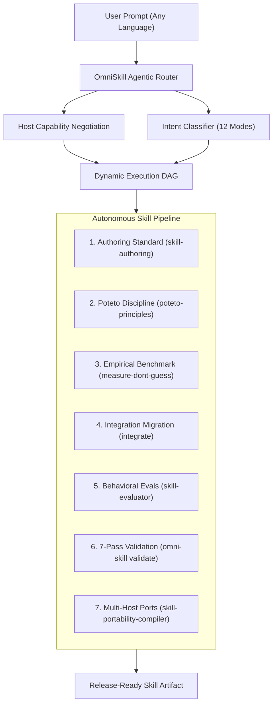

<p align="center">
  
</p>

<h1 align="center">OmniSkill</h1>

<p align="center">
  <strong>Design, test, improve, and package reusable agent skills.</strong>
</p>

<p align="center">
  <a href="#installation">Installation</a> •
  <a href="#poteto-mode">Poteto Mode (24 Principles)</a> •
  <a href="#all-agents-support">All Agents Support</a> •
  <a href="#dynamic-agentic-router">Agentic Router</a> •
  <a href="#skills-suite">Skills Suite</a> •
  <a href="#cli-usage">CLI Usage</a> •
  <a href="#license">License</a>
</p>

<p align="center">
  
  
  
  
  
  
</p>

---

## Overview

**OmniSkill** is the industrial-grade, cross-host evolution of Anthropic's official [`skill-creator`](https://github.com/anthropics/skills/tree/main/skills/skill-creator).

While baseline `skill-creator` provides basic prompt scaffolding for Claude alone, **OmniSkill** elevates skill creation into an autonomous, multi-agent engineering discipline powered by **Poteto Mode** (24 battle-tested engineering principles) and **AgentSkills.io v1 Tripartite Architecture**:

$$\text{Intent (Any Lang)} \longrightarrow \text{Dynamic DAG} \longrightarrow \text{Poteto Gates} \longrightarrow \text{BinEval Harness} \longrightarrow \text{Cross-Host Release}$$

---

## What you can do

- Turn a repeated workflow or SOP into a skill with explicit decision rules.
- Evaluate activation boundaries, instruction quality, and pressure cases.
- Inspect skill code and resources with static security checks.
- Adapt the portable core to target hosts while recording capability gaps.
- Package reviewed skills and prepare distribution metadata.

Each result needs evidence appropriate to its claim. Static validation is not
behavioral proof, and a test on one agent host does not verify another host.

---

## ChatGPT and Codex plugin

The skills-only plugin provides guided setup and routes skill design, repair,
evaluation, host adaptation, and packaging to focused workflows. It needs no
MCP server or API key. File access and execution depend on the current host.

Build the upload archive from a checkout:

```bash
python3 scripts/plugin_package.py . /tmp/omni-skill-plugin.zip
python3 -m unittest discover -s tests -p 'test_plugin_*.py'
```

Upload the resulting ZIP at [OpenAI Platform Plugins](https://platform.openai.com/plugins).
Run **Set Up OmniSkill** after a test install. Start with “Turn this recurring
workflow into a skill with clear triggers, decision rules, and evaluation cases.”
The package includes portable `plugin.json`, a Codex compatibility manifest,
16 skills, and branding. Source development tests and CLI binaries stay outside
this archive. Plugin package version **6.1.1** is separate from CLI version **6.1.0**.

See [submission preparation](docs/plugin-submission.md) for host smoke cases,
listing fields, and the publisher details still requiring portal confirmation.
Local validation does not mean OpenAI approval or a tested installation.

## Installation

### 1. Claude Code Native Marketplace
Inside Claude Code:
```bash
/plugin marketplace add imMamdouhaboammar/omni-skill
/plugin install omni-skill@imMamdouhaboammar
```
Or from your shell:
```bash
claude plugin marketplace add imMamdouhaboammar/omni-skill
claude plugin install omni-skill@imMamdouhaboammar
```

### 2. Vercel Skills CLI
```bash
npx skills add imMamdouhaboammar/omni-skill
```

### 3. Homebrew (macOS & Linux)
```bash
brew tap imMamdouhaboammar/omni-skill https://github.com/imMamdouhaboammar/omni-skill
brew install omni-skill
```

### 4. Global Bun / npm CLI
```bash
bun add -g @mamdouh-aboammar/omni-skill
# Or run ad-hoc
bunx @mamdouh-aboammar/omni-skill --help
```

---

## Poteto Mode: The 24 Engineering Principles

OmniSkill embeds Cursor's and masseater's battle-tested 24 engineering principles directly into its core engine and skill library:

- **[`attack-the-premise`](skills/poteto-principles/references/attack-the-premise.md)**: Suspect the shared premise when multiple fixes fail.
- **[`boundary-discipline`](skills/poteto-principles/references/boundary-discipline.md)**: Consolidate validation at the perimeter; trust internal types unconditionally.
- **[`build-the-lever`](skills/poteto-principles/references/build-the-lever.md)**: Replace manual repetition with rerunnable scripts and codemods.
- **[`encode-lessons-in-structure`](skills/poteto-principles/references/encode-lessons-in-structure.md)**: Turn recurring rules into linters, schemas, and validators.
- **[`explain-the-number`](skills/poteto-principles/references/explain-the-number.md)**: Name the resource bounding every measured number ("why not double?").
- **[`fix-root-causes`](skills/poteto-principles/references/fix-root-causes.md)**: Trace defects to underlying mechanisms; never patch symptoms.
- **[`make-operations-idempotent`](skills/poteto-principles/references/make-operations-idempotent.md)**: Ensure commands converge correctly regardless of retries.
- **[`migrate-callers-then-delete-legacy-apis`](skills/poteto-principles/references/migrate-callers-then-delete-legacy-apis.md)**: Eliminate old APIs in the same wave as new ones.
- **[`model-the-domain`](skills/poteto-principles/references/model-the-domain.md)**: Make invalid states unrepresentable in domain data structures.
- **[`prove-it-works`](skills/poteto-principles/references/prove-it-works.md)**: Check the real runtime directly; never rely on proxies or self-reports.
- **[`subtract-before-you-add`](skills/poteto-principles/references/subtract-before-you-add.md)**: Excise dead code, unused shims, and speculative scaffolding first.
- **[`type-system-discipline`](skills/poteto-principles/references/type-system-discipline.md)**: Model variants with discriminated unions; parse at boundaries.

*See [`skills/poteto-principles`](skills/poteto-principles) for all 24 principles.*

---

## Skills Suite

OmniSkill includes fifteen modular, certified sub-skills:

### 1. Engineering Discipline Suite
| Skill | Directory | Job |
|---|---|---|
| **`poteto-principles`** | [`skills/poteto-principles`](skills/poteto-principles) | 24 battle-tested engineering principles for architecture, refactoring, and code review. |
| **`measure-dont-guess`** | [`skills/measure-dont-guess`](skills/measure-dont-guess) | Empirical measurement, hypothesis formulating, and bounds analysis before implementation. |
| **`dont-it-yourself`** | [`skills/dont-it-yourself`](skills/dont-it-yourself) | Standard library and ecosystem package reuse; bans duplicate wrappers and helpers. |
| **`integrate`** | [`skills/integrate`](skills/integrate) | Adopting new tools, migrating all call sites, and mechanically enforcing legacy lockout. |
| **`humanity-and-humanness`** | [`skills/humanity-and-humanness`](skills/humanity-and-humanness) | Human cognitive grounding: inferential reading, strawman drafts, and intent alignment. |
| **`writing`** | [`skills/writing`](skills/writing) | High-density technical writing: direct payload invariant and zero narrative filler. |
| **`skill-authoring`** | [`skills/skill-authoring`](skills/skill-authoring) | Canonical AgentSkills.io v1 authoring standard with mandatory rationale and tripartite layout. |

### 2. Autonomous Toolchain & Lifecycle Suite
| Skill | Directory | Job |
|---|---|---|
| **`omni-skill`** | [`skills/omni-skill`](skills/omni-skill) | Master orchestrator and dynamic router across all agent hosts. |
| **`skill-conductor`** | [`skills/skill-conductor`](skills/skill-conductor) | Full lifecycle conductor: BinEval scoring, trigger optimization loops, and automated packaging. |
| **`repo-craft-and-distribute`** | [`skills/repo-craft-and-distribute`](skills/repo-craft-and-distribute) | Universal multi-agent manifest distributor and GitHub repository crafter. |
| **`skill-architect`** | [`skills/skill-architect`](skills/skill-architect) | Architecture-first design, workflow/SOP compilation, and freedom calibration. |
| **`skill-evaluator`** | [`skills/skill-evaluator`](skills/skill-evaluator) | Activation trigger banks, BinEval assertions, held-out splits (70/30), and pressure testing. |
| **`skill-portability-compiler`** | [`skills/skill-portability-compiler`](skills/skill-portability-compiler) | Cross-host adapter compiler generating target manifests and capability gap reports. |
| **`host-workspace-operator`** | [`skills/host-workspace-operator`](skills/host-workspace-operator) | Safe, read-first workspace operations mapped to host-native capabilities. |
| **`sandbox-python-executor`** | [`skills/sandbox-python-executor`](skills/sandbox-python-executor) | Deterministic Python helper for parsing, hash verification, and archive inspection. |

---

## ⚡ Dynamic Agentic Router



---

## CLI Usage

```bash
# 1. Dynamic Agentic Router
omni-skill route "integrate drizzle orm and migrate prisma" --explain
omni-skill route "benchmark latency before optimizing" --explain
omni-skill route "قيس السرعة قبل التعديل" --explain

# 2. Initialize a new tripartite skill package
omni-skill init my-skill -d "High performance query optimizer"

# 3. Run the 7-pass static validator
omni-skill validate skills/omni-skill
omni-skill validate skills/poteto-principles

# 4. Port a skill to any AI agent (Claude, Cursor, Codex, Windsurf, Antigravity)
omni-skill port examples/sql-optimizer --target cursor
omni-skill port examples/sql-optimizer --target claude
omni-skill port examples/sql-optimizer --target codex

# 5. Run BinEval test harness (with candidate response or per-case evidence)
omni-skill eval examples/sql-optimizer --candidate "Use EXPLAIN to inspect query plans and verify index usage."
omni-skill eval examples/sql-optimizer --responses examples/sql-optimizer/evals/responses.json --json
```

---

## Testing & Quality Assurance

```bash
# Run Bun unit test suite
bun test

# Run Python core engine tests
python3 packages/core/test_engine.py

# Run 7-pass validation across all skills
for s in skills/*; do bun run packages/cli/src/index.ts validate "$s"; done
```

---

## License

Distributed under the [MIT License](LICENSE). See [PRIVACY.md](PRIVACY.md), [TERMS.md](TERMS.md), and [SUPPORT.md](SUPPORT.md).
